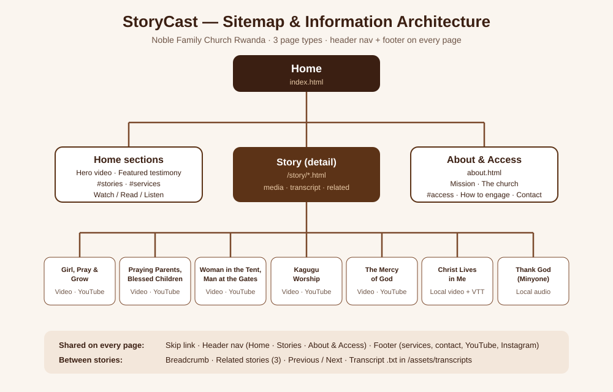

<div align="center">

# 🎙️ StoryCast

### Stories of faith, family and God’s faithfulness from **Noble Family Church Rwanda**

</div>

---

## 📖 The story behind StoryCast

Every week at **Noble Family Church** in Kigali, people stand up and share what God has done in their lives. A young woman talks about prayer and never giving up. A mother teaches parents to cover their children in prayer. A worship team sings that *Christ lives in me*. Those moments are recorded, but they are spread across different YouTube channels, mostly in Kinyarwanda, and hard to reach for someone who:

- cannot hear the video,
- cannot see the screen,
- only uses a keyboard,
- or does not speak Kinyarwanda.

**StoryCast puts those stories in one place and makes each one accessible to everyone.** Every story has an accessible player, an English transcript, the scripture behind the message, key takeaways and related stories to explore next.

> *“And he spake a parable unto them to this end, that men ought always to pray, and not to faint.”* (Luke 18:1)

---

## ⛪ About Noble Family Church Rwanda

Noble Family Church is a church family in **Kigali, Rwanda**, led by **Apostle Mignonne Kabera**, whose ministry also reaches people through **Women Foundation Ministries**. The church has a heart for families: parents who pray, children who grow, and husbands and wives who love each other well.

### 🕰️ Service times

| Day | Time | Service |
| --- | --- | --- |
| Monday | — | No service |
| **Tuesday** | 5:00 PM | Evening service |
| **Wednesday** | **11:00 AM** | Morning service |
| **Thursday** | 5:00 PM | Evening service |
| **Friday** | 5:00 PM | Evening service |
| **Saturday** | 5:00 PM | Evening service |
| **Sunday** | **11:00 AM** | Morning service |

*All times are Central Africa Time (CAT).*

### 🔗 Stay connected

| | |
| --- | --- |
| ▶️ YouTube | [@womenfoundationministries2026](https://www.youtube.com/@womenfoundationministries2026) |
| 📸 Instagram | [@noblefamilychurch](https://www.instagram.com/noblefamilychurch) |
| ✉️ Email | [r.umutesi1@alustudent.com](mailto:r.umutesi1@alustudent.com) |

---

## 🎬 The stories

The home page opens with the church’s **Harvest Service, “1000 Consolations” (Isaiah 40:1)**, from Fire Week with Apostle Mignonne Kabera, playing quietly in the background. Visitors can pause it or turn the sound on.

| | Story | Who | Message | Scripture | Media |
| --- | --- | --- | --- | --- | --- |
| 🌱 | [**Girl, Pray and Grow for Impact**](story/girl-pray-and-grow.html) | Miss Naomie Nishimwe | A girl who prays grows, and a girl who grows makes an impact. Never give up on God. | Luke 18:1 | YouTube · 41:19 |
| 👨‍👩‍👧 | [**Praying Parents, Blessed Children**](story/parents-pray-for-children.html) | Apostle Mignonne Kabera & Miss Naomie | Parents must pray for their children, and children who honour that prayer receive greater blessing. | Isaiah 54:13 | YouTube · 2:12:43 |
| 💍 | [**The Woman in the Tent, the Man at the Gates**](story/husband-and-wife-love.html) | Apostle Mignonne Kabera | *Umugore mu ihema, umugabo mu marembo*: how a husband and wife are called to love and protect each other. | Genesis 18:9 | YouTube · live replay |
| 🎶 | [**Worship at the Kagugu Reopening Service**](story/kagugu-worship.html) | Noble Family Church worship team | The first Sunday back in Kagugu, filled with songs of thanksgiving. | Psalm 100:4 | YouTube · 40:03 |
| 🙏 | [**The Mercy of God**](story/mercy-of-god.html) | Pastor Frank Karemera | Having God in your life is the greatest blessing, and His mercy is new every morning. | Lamentations 3:22–23 | YouTube · 1:08:05 |
| ✝️ | [**Christ Lives in Me**](story/christ-lives-in-me.html) | Aime Frank | *Nabambanwe na Kristo*: I am crucified with Christ, and Christ now lives in me. | Galatians 2:20 | Local video + captions · 13:21 |
| 🎧 | [**Thank God**](story/thank-god-minyone.html) | Minyone | A short song of gratitude: whatever comes, thank God. | 1 Thessalonians 5:18 | Local audio · 3:19 |

---

## 🗺️ Information architecture

Three page types, connected by the main navigation, breadcrumbs, related stories and previous/next links.



| Page | File | What you find there |
| --- | --- | --- |
| 🏠 **Home** | [`index.html`](index.html) | Background video with Pause/Sound controls, featured testimony, all 7 stories, service times, and the watch/read/listen options |
| 📄 **Story (detail)** | [`story/*.html`](story/) | Player inside a `<figure>`, story facts, scripture, key takeaways, transcript (show/hide + `.txt` download), previous/next, related stories |
| ♿ **About & Access** | [`about.html`](about.html) | Mission, vision and values, the church, accessibility features, how to engage, accessibility contact |

---

## 🎨 Design: chocolate brown & white

A warm, simple palette chosen for contrast and calm. **Every text colour pair passes WCAG 2.1 AA, and most pass AAA.**

| Colour | Hex | Used for | Contrast |
| --- | --- | --- | --- |
| 🟫 Chocolate 900 | `#3B1F12` | Body text, header, footer | **15.1 : 1** with white |
| 🟫 Chocolate 700 | `#5C3317` | Brand, buttons, links | **10.8 : 1** with white |
| 🟫 Chocolate 500 | `#7B4A2D` | Labels and tags | **7.3 : 1** with white |
| 🟤 Muted | `#6E5547` | Secondary text | **6.3 : 1** on cream |
| 🟨 Caramel 200 | `#E8C9A6` | Text and focus ring on dark areas | **9.6 : 1** on chocolate |
| ⬜ White / Cream | `#FFFFFF` / `#FAF5EF` | Page backgrounds | — |

**Typography:** Merriweather for headings, Poppins for body text, with fluid sizes using `clamp()`.

---

## 🧱 How it’s built

### Project structure

```
storycast/
├─ index.html                  🏠 Home
├─ about.html                  ♿ About & Access
├─ story/                      📄 7 story detail pages
├─ css/main.css                🎨 Compiled CSS (generated, edit sass/ instead)
├─ sass/
│  ├─ main.scss                Entry point: loads every partial in layer order
│  ├─ _layers.scss             @layer reset, tokens, base, layout, components, pages, utilities
│  ├─ tokens/                  _colors · _typography · _spacing · _breakpoints
│  ├─ base/                    _reset · _base
│  ├─ layout/                  _grid · _header · _footer
│  ├─ components/              _buttons · _navigation · _hero · _story-card · _media · _transcript · _schedule
│  ├─ pages/                   _home · _story · _about
│  └─ utilities/               _accessibility
├─ js/
│  ├─ hero.js                  Background video (YouTube IFrame API) + Pause/Sound + aria-live
│  └─ transcript.js            Transcript show/hide (aria-expanded / aria-controls)
├─ assets/
│  ├─ video/amashimwe.mp4      “Christ Lives in Me” (Git LFS)
│  ├─ audio/                   “Thank God” by Minyone
│  ├─ images/                  Story photos, video poster, favicon
│  └─ transcripts/             One .txt per story + christ-lives-in-me.en.vtt captions
└─ doc/                        Research & documentation PDF, sitemap
```

### Sass architecture

- **Tokens:** colours become CSS custom properties; spacing uses a map plus a `space()` function; breakpoints use an `up()` mixin.
- **Cascade layers:** every partial sits in its own `@layer`, so the layer order (not selector specificity) decides which rule wins.
- **BEM naming:** `.story-card__title`, `.btn--primary`, `.schedule__item--morning`, …
- **Grid + Flexbox:** Grid handles page layouts (story grid, story + sidebar, footer); Flexbox handles rows (header, buttons, media).

### 📦 The container query

Story cards respond to **the space they are placed in**, not to the screen size:

```scss
.story-grid__item { container: story-card / inline-size; }

@container story-card (max-width: 18rem) { /* compact card, excerpt hidden */ }
@container story-card (min-width: 32rem) {
  .story-card { grid-template-columns: 40% 1fr; } /* horizontal card */
}
```

The same card is **stacked** in the home grid, **stacked** in the story sidebar on desktop, and **horizontal** in the full-width related list on tablets.

---

## ♿ Accessibility checklist (WCAG 2.1 AA)

| ✔ | Requirement | How StoryCast meets it |
| --- | --- | --- |
| ✅ | **Semantic HTML** | `header`, `nav`, `main`, `article`, `section`, `aside`, `figure`/`figcaption`, `footer`, `dl`, `blockquote`, `time`. One `h1` per page, no skipped heading levels. |
| ✅ | **Captions** | The local video has a `<track kind="captions">` WebVTT file; YouTube embeds turn captions on with `cc_load_policy=1`. |
| ✅ | **Transcripts** | Every story has an on-page English transcript plus a downloadable `.txt` in `assets/transcripts/`. |
| ✅ | **Colour contrast** | Lowest text contrast is 6.3 : 1 (the AA minimum is 4.5 : 1). |
| ✅ | **Keyboard** | “Skip to main content” link, logical tab order, only native links and buttons. |
| ✅ | **Visible focus** | A 3px `:focus-visible` ring everywhere that switches to caramel on dark backgrounds. |
| ✅ | **Moving media** | The background video starts muted, can be paused, and stays paused with `prefers-reduced-motion`. |
| ✅ | **ARIA where needed** | `aria-current`, `aria-labelledby`, `aria-expanded` + `aria-controls`, `aria-live`, `aria-describedby`, and `aria-hidden` on decorative icons. |
| ✅ | **Images** | Descriptive `alt` text on photos; `alt=""` on card thumbnails because the title already names the story. |
| ✅ | **New tabs** | Screen readers announce “opens in a new tab”. |
| ✅ | **Automated test** | axe-core 4.10 (WCAG 2.0/2.1 A + AA + best practice) reported **0 violations** on the Home, About and story pages tested. |

---

## 🚀 Run it locally

```bash
# 1. Get the code (Git LFS is needed for the video)
git lfs install
git clone https://github.com/rhoda-n1cole/storycast.git
cd storycast

# 2. Install Sass once
npm install -g sass

# 3. Compile the styles (keeps watching while you edit)
sass --watch sass/main.scss css/main.css

# 4. Serve the folder (needed for the caption track to load)
python -m http.server 5500     # then open http://localhost:5500
```

💡 In VS Code you can also right-click `index.html` → **Open with Live Server**.

---

## 📝 Notes

- 🌍 **Language:** the messages are preached in Kinyarwanda. The transcripts are **English summaries** of the main points, not word-for-word translations. Full lyrics for “Thank God” are still to be added.
- 🎥 **Hosting:** GitHub Pages does not serve Git LFS files. If the site is hosted there, the local video shows its poster with a “Watch on YouTube” link and the transcript, and all other media works normally.
- ©️ **Credits:** videos and photos belong to Noble Family Church Rwanda, Women Foundation Ministries and the channels credited on each story page (IWACU Filmz, HIMBAZA TV, New Life Rwanda, Unity Mulenge S).

---

<div align="center">

**Built with 🤎 by Nicole Umutesi for Noble Family Church Rwanda**

*“In every thing give thanks: for this is the will of God in Christ Jesus concerning you.”* (1 Thessalonians 5:18)

</div>
